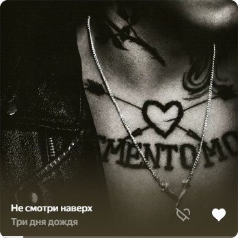
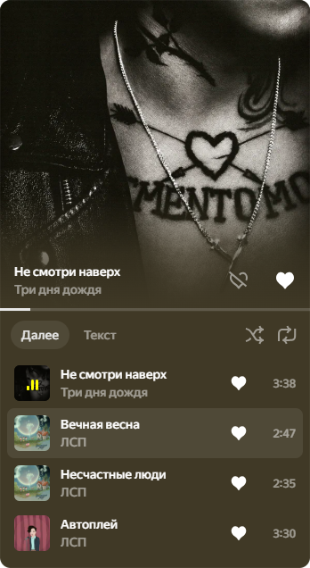
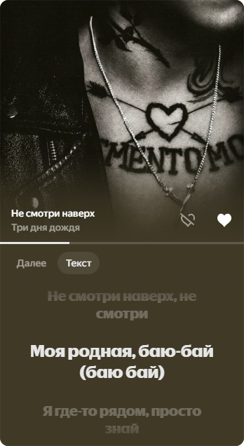
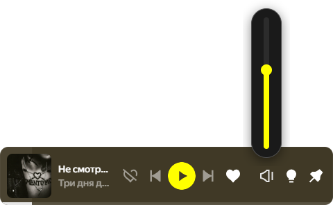

# Yandex Music Widget

Виджет плеера для Яндекс Музыки на Windows 11. Небольшое окно поверх остальных: обложка, управление, очередь и текст песни — без переключения в приложение. Оформление повторяет саму Яндекс Музыку: шрифты, цвета, иконки и компоненты берутся из установленного приложения.

<p align="center">
  
  
</p>
<p align="center">
  
  
</p>
<p align="center">
  
</p>

## Возможности

- **Два режима.** Квадрат с обложкой — управление появляется при наведении. Компактная полоса — как плеер-бар Яндекс Музыки: громкость, свечение и закрепление выезжают при наведении. Ширину меняют, потянув за край. Длинное название при наведении прокручивается бегущей строкой.
- **Видеообложки.** Если у трека есть видеообложка, как в мобильном приложении, в большом режиме вместо картинки крутится короткое видео без звука. Оно идёт, только пока играет музыка и виджет виден. Выключается в меню трея.
- **Управление.** Пауза, следующий и предыдущий трек, перемотка, «Нравится» и «Не нравится» — как в приложении, дизлайк сразу переключает на следующий трек.
- **Громкость.** Вертикальный слайдер у кнопки громкости при наведении, как в приложении (если сверху нет места — под кнопкой, поверх обложки); щелчок по кнопке выключает звук. Колесо мыши над кнопкой или над обложкой тоже меняет громкость.
- **Очередь.** Что играет дальше, переход к любому треку, перемешивание и повтор.
- **Текст песни.** Синхронный текст из Яндекс Музыки с той же анимацией, что в приложении: текущая строка посередине, спетые и следующие видны приглушённо. Щелчок по любой строке перематывает трек к ней. Если в Яндексе текста нет, виджет ищет его в [LRCLIB](https://lrclib.net).
- **Свечение.** Ореол вокруг виджета в цвет обложки ровно горит, пока играет музыка, и отзывается на неё тремя слоями: на ударах бочки вспыхивает весь ореол, на хлопках, малом барабане и тарелках коротко мерцает кромка у края, а пока звучат голос и мелодия, медленно «дышат» два пятна. Отдельных дорожек в треке нет, поэтому виджет делит звук по форме: удары короткие и широкие по частотам, голос и мелодия длинные и узкие. Бочка отличается от тянущегося баса (808 в рэпе) по тому, какая доля баса в эту секунду ударная. Звук берётся до регулятора громкости, поэтому свечение одинаково и на 100%, и на 0%: пока свечение включено, громкость Яндекс Музыки применяется внутри её звукового графа, после точки, откуда слушает виджет, — слышно ровно то же самое. Яркость — таким же вертикальным слайдером у кнопки с лампочкой.
- **Окно.** Закрепление поверх всех окон, прилипание к краям экрана, меню в трее. Положение, размер и режим запоминаются.
- **Всегда сверху.** Дважды в секунду виджет спрашивает у Windows, не накрыло ли его другое окно «поверх всех» (игра в окне без рамки, оверлей), и если накрыло — поднимается, не забирая фокус. Поверх игры в эксклюзивном полноэкранном режиме Windows рисовать не даёт: выберите в игре режим «Полноэкранный в окне». Над «Пуском», Alt+Tab, уведомлениями и меню Windows виджет не поднимается. Чьё окно накрыло виджет, записывается в `%APPDATA%\yandex-music-widget\widget.log`.
- **Статус в Discord.** «Слушает Яндекс Музыка»: трек, исполнитель, обложка и полоса времени, как у Spotify. Кнопки со ссылкой нет: статус с ней Discord не показывает другим людям. На паузе статус убирается. Выключается в меню трея.
- **`Ctrl+Alt+M`.** Скрытый виджет показывает, перекрытый — поднимает наверх, видимый — прячет. Скрыть виджет можно этим сочетанием или из меню в трее.
- **Вместе с Яндекс Музыкой.** Запустили виджет — откроется и Яндекс Музыка. Открыли Яндекс Музыку своим ярлыком — появится виджет: он ждёт в трее с входа в Windows, показывается, когда музыка подключена, и прячется, когда её закрыли. Для этого виджет дописывает в ярлыки Яндекс Музыки («Пуск», рабочий стол, закреп на панели задач) порт для подключения. Если её открыли иначе (ссылкой, автозапуском), виджет сразу перезапускает её с портом, пока ничего не играет. Пункт «Закрыть до запуска Яндекс Музыки» в трее убирает виджет и значок, но не выходит совсем: виджет вернётся, когда Яндекс Музыку откроют в следующий раз (или когда его запустят ярлыком). Полностью связка выключается пунктом «Запускать вместе с Яндекс Музыкой» в трее — ярлыки и автозапуск возвращаются как были.
- **Быстрое переключение.** По «следующему» виджет сразу показывает следующий трек из очереди, не дожидаясь, пока Яндекс Музыка его загрузит; пока трек грузится, по кнопке воспроизведения бежит дуга. В конце очереди кнопка неактивна, как в приложении.
- **Обновления.** Виджет сам проверяет новые версии на GitHub, скачивает их и ставит, когда музыка не играет: закрывается на несколько секунд и запускается уже обновлённым. В меню трея — пункт «Проверить обновления»: он же показывает, что идёт проверка или скачивание, а когда версия скачана, превращается в «Обновить до … сейчас».
- **Панель задач.** В меню трея можно включить кнопку виджета на панели задач: щелчок по ней сворачивает и возвращает виджет. Ярлык в «Пуске» показывает уже запущенный виджет.

<p align="center">
  
  
</p>

## Установка

1. Скачайте `yandex-music-widget-setup-<версия>.exe` из [последнего релиза](https://github.com/dobriy-vecher-vlad/yandex-music-widget/releases/latest) и запустите.
2. Установщик не подписан, поэтому SmartScreen покажет «Неизвестный издатель»: нажмите «Подробнее» → «Выполнить в любом случае».
3. Виджет ставится только для вашей учётной записи, права администратора не нужны.
4. Дальше виджет обновляется сам.

Нужна установленная [Яндекс Музыка для Windows](https://music.yandex.ru/download/). Виджет проверялся на Windows 11 x64.

Удаляется виджет через «Параметры → Приложения → Установленные приложения». Настройки при удалении сохраняются в `%APPDATA%\yandex-music-widget`.

## Как это работает

Виджет — отдельное приложение на Electron; файлы Яндекс Музыки он не изменяет. Он запускает её с портом отладки Chromium (`--remote-debugging-port=9339`, доступен только локально), подключается к странице приложения по Chrome DevTools Protocol и внедряет небольшой адаптер. Адаптер читает состояние плеера, очередь и текст песни из внутренних моделей приложения и выполняет команды виджета. Когда виджет закрыт, адаптер останавливается и не нагружает Яндекс Музыку.

Статус в Discord виджет передаёт через локальный канал Discord (`\\?\pipe\discord-ipc-N`) от имени приложения «Яндекс Музыка» в Discord Developer Portal; сторонние библиотеки для этого не нужны. Окна Windows, лежащие поверх виджета, он находит через [koffi](https://koffi.dev) — вызовом `WindowFromPoint` из `user32.dll`.

Если Яндекс Музыка уже запущена обычным способом, виджет предложит перезапустить её. Шрифты, иконки и цветовые токены берутся из установленного приложения, поэтому виджет следует его оформлению и теме.

Внутреннее устройство Яндекс Музыки знает только [src/ym/adapter.page.js](src/ym/adapter.page.js): если обновление приложения что-то сломает, править нужно его.

## Разработка

```bash
npm install
npm start
```

| Команда | Что делает |
| --- | --- |
| `npm start` | запускает виджет из исходников |
| `npm run dist` | собирает установщик в `release/` |
| `npm run icon` | перерисовывает `build/icon.ico` и `build/icon.png` из `build/icon.svg` |

Структура:

- `src/main` — главный процесс: окна, трей, прилипание и изменение размера, настройки, обновления.
- `src/renderer` — интерфейс виджета.
- `src/glow` — прозрачное окно под виджетом: свечение и тень.
- `src/popup` — окно вертикального слайдера громкости и яркости свечения.
- `src/ym` — запуск Яндекс Музыки, связь по CDP и адаптер.
- `src/lyrics` — поиск текстов в LRCLIB.
- `src/discord` — статус «Слушает» в Discord.
- `build` — иконка и дополнения к установщику NSIS (`installer.nsh`).

## Отказ от ответственности

Неофициальный проект, не связан с Яндексом. «Яндекс Музыка» — товарный знак ООО «Яндекс».
